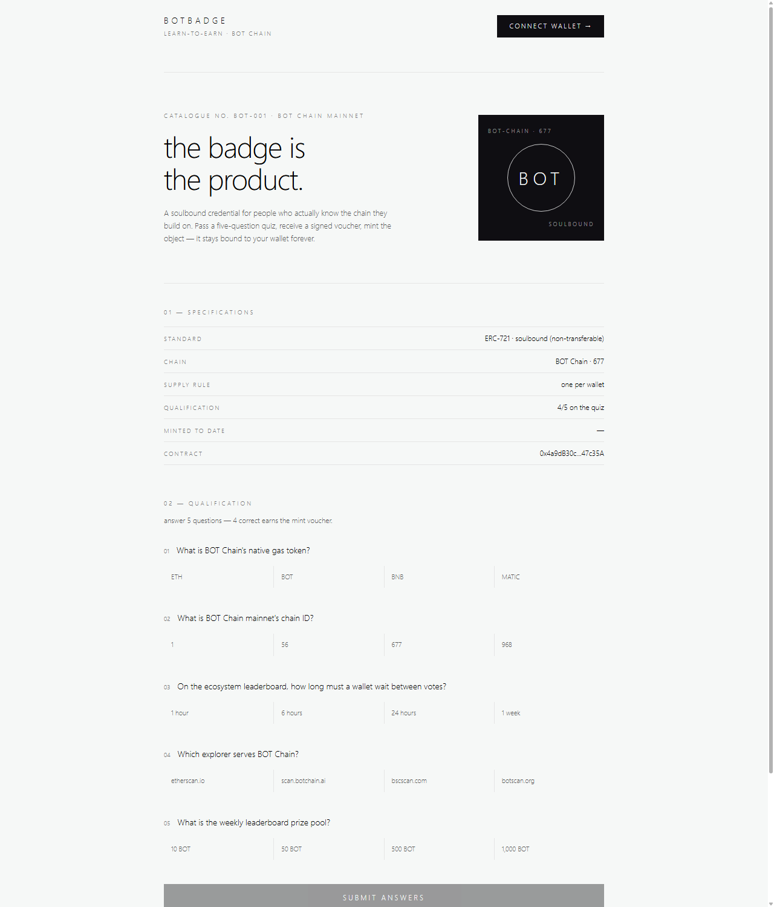
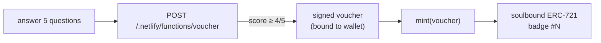

# BotBadge — Learn-to-Earn Badge on BOT Chain

> A free, non-transferable (soulbound) ERC-721 badge earned by passing a
> five-question quiz about BOT Chain. One badge per wallet, bound forever.

**Live:** [botchain-botbadge.netlify.app](https://botchain-botbadge.netlify.app/) ·
**Contract:** [`0x4a9dB30ca84Ca851ded1432Be7Fb2ce91047c35A`](https://scan.botchain.ai/address/0x4a9dB30ca84Ca851ded1432Be7Fb2ce91047c35A)
(proxy — permanent address) ·
**X:** [@botbadgeai](https://x.com/botbadgeai)



## The problem it solves

Ecosystems hand out "proof of participation" NFTs to anyone who clicks a
button — so they prove nothing. BotBadge is a minimal credential with a real
gate: you only hold it if you actually know the chain you're building on.
Soulbound means it can't be bought, sold, or transferred — possession *is*
the proof.

## What it does

1. **Quiz** — five questions about BOT Chain (gas token, chain ID, the
   leaderboard, the explorer, the prize pool).
2. **Server-verified voucher** — `POST /.netlify/functions/voucher` scores your answers
   server-side (the answer key never reaches the browser) and, on ≥4/5,
   returns an EIP-191 signature over `keccak256(contract, chainId, recipient)`
   bound to *your* wallet.
3. **Mint** — present the voucher to `mint(voucher)`. The contract recovers
   the signer, enforces one-per-wallet, and issues a token that can never
   leave it.



## Built with

| Piece | Choice | Why |
|---|---|---|
| App | Next.js (App Router) + TypeScript + Tailwind v4 | App + signing API in one deploy |
| Chain client | ethers v6 | `JsonRpcProvider` reads, `BrowserProvider` signs |
| Wallets | EIP-6963 discovery + `window.ethereum` fallback | Works with any injected EVM wallet |
| Contract | Solidity 0.8.30, OZ upgradeable ERC-721 + UUPS | Permanent proxy address, upgradeable implementation |
| Toasts | sonner | Non-blocking feedback for every state |
| Design | teenage engineering system (Refero) | "The product is the only rich object" — the badge is the hero |

## Contract surface

`contracts/BotBadge.sol` — UUPS-upgradeable soulbound ERC-721.

- `mint(voucher)` → tokenId — requires a valid `voucherSigner` EIP-191
  signature over `(contract, chainId, recipient)`; one per wallet
- `badgeOf(addr)` → (tokenId, has) · `hasMinted(addr)` · `totalMinted()`
- `setVoucherSigner(addr)` — owner only (rotate the quiz backend key)
- Transfers blocked in `_update` — mint and burn remain possible
- `initialize(owner, voucherSigner)` on the proxy; implementation is
  [verified-linked](https://scan.botchain.ai/address/0x4a9dB30ca84Ca851ded1432Be7Fb2ce91047c35A)
  (impl `0x8390E6DA…b99f`; source-verify is currently blocked by a
  Blockscout Cloudflare rule — see *Known limitations*)

## Security notes

- `VOUCHER_KEY` signs — it never leaves the server (`app/.env.local`,
  gitignored) and holds no funds; worst case on leak is free mints, fixable
  by rotating `setVoucherSigner`.
- The answer key lives in `app/src/lib/answers.ts`, imported only by the
  API route — it is not in the client bundle.
- `POST /.netlify/functions/voucher` validates address format, answer array shape and
  per-element bounds, and rate-limits per IP (20 attempts / 10 min,
  best-effort under serverless).
- The voucher binds `contract + chainId + recipient` — it can't be
  redeemed by or for another wallet or chain.

## Real vs. mocked

Everything on-chain is real: reads hit `rpc.botchain.ai`, mints are real
transactions on BOT Chain mainnet. Nothing in the UI is mocked. The only
abstraction is the quiz backend itself (off-chain scoring + signing, which
is by design — answers can't be checked on-chain without leaking them).

## Run locally

```bash
# app
cd app
npm install
cp .env.example .env.local   # VOUCHER_KEY=0x… (any dedicated key)
npx netlify dev              # serves the site AND the voucher function
```

`next dev` alone works for the UI but the voucher endpoint 404s (it lives in
`netlify/functions/`, which only `netlify dev` or a deploy runs) — the app
surfaces this as the designed "voucher service unreachable" error state.

The contract is already deployed and initialized on mainnet — the local
`VOUCHER_KEY` must derive the address set as `voucherSigner` on-chain for
vouchers to verify.

## Deploy your own

```bash
npm install
cp .env.example .env         # DEPLOYER_KEY + OWNER_ADDRESS + VOUCHER_SIGNER
npm run deploy               # writes deployed.json + app/src/lib/contract.ts
```

## Known limitations

- **Voucher replay is harmless but exists** — the same correct submission
  returns an equivalent signature; the contract enforces one-per-wallet, so
  at worst a wallet mints once. No expiry/nonce on vouchers.
- **Rate limiter is in-memory** — resets per serverless instance. Enough to
  raise brute-force cost, not a hard guarantee.
- **Implementation source-verify pending** — Blockscout's WAF 403s the
  standard-json payload (OZ `Bytes.sol`'s `concat(` trips a managed rule).
  `scripts/verify.mjs` replays the exact compile and resubmits once fixed.
  Proxy→implementation linkage already shows on the explorer.
- The quiz is a knowledge gate, not sybil resistance — anyone who knows the
  answers (or finds another app whose answers differ) passes.

## License

MIT — see [LICENSE](LICENSE). OpenZeppelin contracts MIT. Inter and
JetBrains Mono under OFL. Design language adapted from
[teenage.engineering](https://teenage.engineering) via
[Refero](https://styles.refero.design); BOT Chain wordmark from the
official [BOT Chain brand kit](https://www.botchain.ai).
